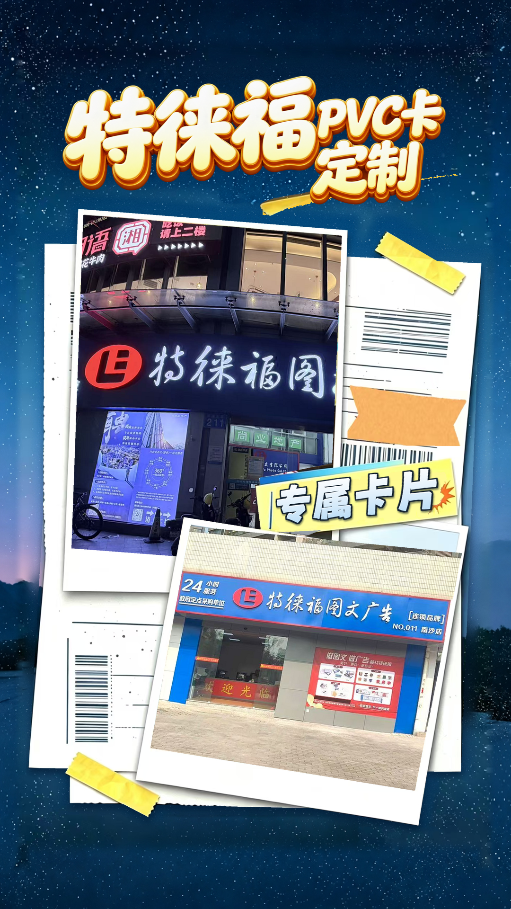

# 特徕福信息流 A 版封面

`telaifu-coverA` 是一个 Codex Skill。提供封面标题和两张配图，即可生成一张 **1080 × 1920（9:16）PNG**。A 版使用深蓝星空、奶金色立体标题、白边相框和随标题变化的四字贴纸。

## 成片示例

这张封面以夜景门店为主图、白天门店为副图，贴纸抽中「专属卡片」。[查看这张封面的制作记录](references/approved-pvc-workflow.md)。

## 安装

在 Windows PowerShell 中，登录有仓库访问权限的 GitHub 账号，然后将仓库克隆到 Codex 的个人 Skills 目录。

~~~powershell
$codexDir = if ($env:CODEX_HOME) { $env:CODEX_HOME } else { Join-Path $env:USERPROFILE '.codex' }
$skillsDir = Join-Path $codexDir 'skills'
New-Item -ItemType Directory -Path $skillsDir -Force | Out-Null
git clone https://github.com/Valentina-Qiao/telaifu-coverA.git (Join-Path $skillsDir 'telaifu-coverA')
~~~

也可以下载仓库，解压后把包含 `SKILL.md` 的文件夹命名为 `telaifu-coverA`，放入同一目录。

## 使用

在 Codex 里说「制作特徕福信息流 A 版封面」，或输入 `$telaifu-coverA`。附上标题和照片，例如：

> 制作特徕福信息流 A 版封面，标题为「特徕福PVC卡定制」。第一张放左上，第二张放右下。

默认按配图顺序入框。也可以指定主副图、标题换行和四字贴纸文案。

## 工作流程

1. 用 ImageGen 按[字形参考](assets/headline-style-reference.png)生成透明主标题层，逐字核对。随包字稿可直接复用。
2. 从标题提炼贴题的四字候选，由脚本随机选出一个，或使用你指定的短语。
3. 把标题、贴纸和原照片合成到固定模板中，按可见内容垂直居中。调整取景时复用已确认的标题和贴纸。
4. 检查成片的文字、照片主体及上下留白，导出 PNG。

本地合成需要带 Pillow 和 NumPy 的 Python。直接运行脚本时，请参考 [SKILL.md 中的渲染参数](SKILL.md#渲染参数)。
